# Alya VPN 🛡️

[](https://github.com/alya-lang/alya)
[](LICENSE)
[](#security--cryptography)
[](#split-tunneling-engine)

High-performance, secure, per-application split-tunneling VPN client & server built for the [Alya Programming Language](https://github.com/alya-lang/alya).

---

## 🌟 Highlights

- **Per-Application Split-Tunneling:** Route only specific applications (e.g. Discord, Steam) through the encrypted VPN tunnel, or exclude specific applications while tunneling everything else.
- **Zero External Runtime Dependencies:** Cryptographic operations (ChaCha20-Poly1305 AEAD + SHA-256 KDF) and OS kernel process lookup are compiled directly into the binary via Alya's native `[build]` directive.
- **Client-Server Architecture:** Run the headless VPN server on any remote Linux VPS or cloud instance, and connect seamlessly from local clients (Windows, macOS, Linux).
- **Local SOCKS5 Proxy:** Client provides a standard local SOCKS5 proxy (`127.0.0.1:1080`). Any application, browser, or OS-level proxy settings can route through it.
- **Dynamic Process Inspection:** Resolves incoming local TCP connections to the originating executable name in real time (via `GetExtendedTcpTable` on Windows and `/proc/net/tcp` on Linux).
- **Hardened Wire Framing:** Custom binary-safe envelope protocol (`AV01`) featuring CSPRNG-generated nonces, Poly1305 message authentication codes (MAC), and tamper rejection.

---

## 📐 Architecture Overview

```mermaid
flowchart LR
    subgraph Client ["Client Machine (Local)"]
        direction TB
        AppDiscord["Discord.exe / Games"] -->|SOCKS5 Port| LocalProxy["Alya SOCKS5 Proxy\n(127.0.0.1:1080)"]
        AppBrowser["Browser / Other Apps"] -->|SOCKS5 Port| LocalProxy
        LocalProxy --> Resolver["OS Process Resolver\n(Port -> PID -> Process)"]
        Resolver --> Router{"Split Tunnel Router\n(include / exclude)"}
        Router -->|VPN Match| Encryptor["ChaCha20-Poly1305 AEAD\nFrame Pack & Encrypt"]
        Router -->|Bypass Match| DirectRelay["Direct Local Bypass\n(Local WAN)"]
    end

    DirectRelay -->|Plain Traffic| InternetDirect["Direct Internet"]

    subgraph Tunnel ["Encrypted Transport Tunnel"]
        Encryptor -->|TCP Envelope AV01| NetWire["Public Network / Internet"]
    end

    subgraph Server ["VPN Remote Server (VPS)"]
        direction TB
        NetWire --> ServerEngine["Alya VPN Server Daemon\n(0.0.0.0:51822)"]
        ServerEngine --> Decryptor["AEAD Decrypt &\nPoly1305 MAC Verification"]
        Decryptor --> Forwarder["Remote Target Forwarder"]
        Forwarder --> TargetDest["Discord Gateway / Web Endpoints"]
    end
```



---

## 🚀 Split-Tunneling Modes

Alya VPN supports 3 intelligent routing modes configured in `config/client.toml`:

### 1. `include` (Whitelist Mode)
Only explicitly listed applications will be tunneled through the remote VPN server. All other applications connect directly to the internet through your local connection.

```toml
[split_tunnel]
mode = "include"
apps = ["Discord.exe", "discord", "steam*"]
```
*Example:* Only Discord voice & gateway traffic uses the VPN to bypass local ISP blocks, while browsers and downloads utilize full unthrottled local bandwidth.

### 2. `exclude` (Blacklist Mode)
All system applications are routed through the VPN tunnel **except** the explicitly specified applications.

```toml
[split_tunnel]
mode = "exclude"
apps = ["Discord.exe", "qBittorrent.exe"]
```
*Example:* All internet traffic goes through the secure VPN server, but Discord and torrent clients bypass the tunnel to maintain low gaming latency or avoid VPS transfer limits.

### 3. `all` (Full Tunnel Mode)
Every connection routed through the SOCKS5 proxy is encrypted and forwarded through the VPN server.

```toml
[split_tunnel]
mode = "all"
apps = []
```

---

## 🔒 Security & Cryptography

Alya VPN employs modern, misuse-resistant cryptographic primitives bundled as native C implementations:

| Primitive | Standard | Purpose |
|---|---|---|
| **ChaCha20** | RFC 8439 | 256-bit high-speed stream cipher with high resistance to side-channel attacks |
| **Poly1305** | RFC 8439 | 128-bit cryptographic message authenticator (one-time MAC per frame) |
| **SHA-256** | FIPS 180-4 | Cryptographic Key Derivation Function (KDF) from the shared secret passphrase |
| **CSPRNG** | Native OS | Secure 96-bit (12-byte) unique nonces generated per frame |

### Frame Wire Format

Each transmitted frame is framed with the `AV01` envelope:

```text
+----------+---------+------------+-------------+--------------+------------------+
| Magic    | Version | Type (hex) | Nonce (hex) | Tag (hex)    | Ciphertext (hex) |
| "AV" (2) | "01"(2) | 2 bytes    | 24 bytes    | 32 bytes     | 2 * N bytes      |
+----------+---------+------------+-------------+--------------+------------------+
```
Any frame with an invalid Poly1305 MAC tag or invalid header is immediately dropped by both the client and server without leaking plaintext data.

---

## 📥 Download & Install

Every tagged release ships prebuilt binaries for Linux, macOS and Windows (`x86_64` + `arm64`) with SHA-256 checksums — see [Releases](https://github.com/alya-lang/vpn/releases/latest):

| Platform | Asset |
|---|---|
| Linux x86_64 / arm64 | `alya-vpn-v<version>-x86_64-linux.tar.gz` / `...-arm64-linux.tar.gz` |
| macOS x86_64 / arm64 | `alya-vpn-v<version>-x86_64-macos.tar.gz` / `...-arm64-macos.tar.gz` |
| Windows x86_64 / arm64 | `alya-vpn-v<version>-x86_64-windows.zip` / `...-arm64-windows.zip` |

```bash
# Linux x86_64 example (replace VERSION with the current tag, e.g. v0.2.13)
VERSION=v0.2.13
curl -LO "https://github.com/alya-lang/vpn/releases/download/${VERSION}/alya-vpn-${VERSION}-x86_64-linux.tar.gz"
curl -LO "https://github.com/alya-lang/vpn/releases/download/${VERSION}/alya-vpn-${VERSION}-x86_64-linux.tar.gz.sha256"
sha256sum -c "alya-vpn-${VERSION}-x86_64-linux.tar.gz.sha256"   # macOS: shasum -a 256 -c
tar -xzf "alya-vpn-${VERSION}-x86_64-linux.tar.gz"
cd "alya-vpn-${VERSION}-x86_64-linux"
./alya-vpn --help
```

Windows zips unpack to `alya-vpn.exe` and can be verified with `Get-FileHash -Algorithm SHA256`. Each archive bundles the binary, the documented `config/*.toml` samples, `README.md` and `LICENSE`.

### Building from source (pinned dependencies)

The repository commits its `alya.lock`; `alya install` resolves exactly the locked workspace-member set, so builds are reproducible across machines:

```bash
git clone https://github.com/alya-lang/vpn && cd vpn
alya install                       # resolve the committed alya.lock
alya build src/main.alya -o alya-vpn
```

---

## 💻 Quick Start & Usage

### Prerequisites
- [Alya Compiler](https://github.com/alya-lang/alya) `v0.0.17` or later installed.
- C compiler (`gcc` or `clang`) for native C compilation via `[build]` directive.

### 1. Run the VPN Server (on VPS)

#### Option A: Using Docker & Docker Compose (Recommended)

Run the headless server instantly in a lightweight container. A prebuilt
multi-arch image (`linux/amd64`, `linux/arm64`) is published to GHCR, so the
host needs no Alya toolchain:

```bash
# Pull the published image and start the server
docker compose up -d
# Or compile the image from this checkout instead (needs network access)
docker compose up -d --build
```
To view logs:
```bash
docker compose logs -f
```

The container runs the shipped `config/server.toml`. **Change the default
passphrase before exposing the server.** CLI flags override the config file,
so a compose override is enough (no image edit, no rebuild):

```yaml
# compose.override.yml
services:
  vpn-server:
    command: ["server", "--config", "/app/config/server.toml", "--pass", "your_secret"]
```

Deploying from **Portainer**: add a stack from the Git repository
(`https://github.com/alya-lang/vpn`, compose path `docker-compose.yml`) and
deploy. The web editor works too — paste the compose file and set
`VPN_PORT` in the stack environment if needed; the prebuilt image makes the
`build:` section unnecessary there.

Windows (Docker Desktop) hosts: if the container fails with
`ports are not available ... access denied`, host port 51822 sits inside a
Hyper-V/WSL excluded range. Check with
`netsh interface ipv4 show excludedportrange protocol=tcp` and map a free
host port instead:

```bash
VPN_PORT=52082 docker compose up -d
# clients then connect with: --server <host>:52082
```
(Or reclaim the reservation with `net stop winnat` / `net start winnat` in an
admin shell.)

#### Option B: Using Alya CLI directly

```bash
alya run src/main.alya -- server
```
*Options:*
- `--port <number>`: Override bind port (default: `51822`).
- `--key <passphrase>`: Specify authentication passphrase.

### 2. Run the Client (on local machine)

```bash
alya run src/main.alya -- client
```
*Options:*
- `--server <host:port>`: VPN server endpoint (default: `127.0.0.1:51822`).
- `--local-port <port>`: Local SOCKS5 listen port (default: `1080`).
- `--mode <all|include|exclude>`: Split tunneling mode.
- `--protocol <tcp|udp|both>`: Forwarded payload types (default: `both`). UDP is carried as UDP-over-TCP datagrams; the SOCKS5 UDP relay listens on `proxy_port + 1`.
- `--apps <app1,app2,...>`: Comma-separated application filters.

### 3. Configure Applications (e.g. Discord)

To route Discord through Alya VPN:
1. Start the client first, then open Discord **afterwards** so it picks up proxy/DNS settings.
2. Either rely on the automatic system proxy, or force Discord (macOS):
   `/Applications/Discord.app/Contents/MacOS/Discord --proxy-server='socks5://127.0.0.1:1080'`
   (`socks5://` resolves hostnames through the tunnel, which is what the domain rules need).
3. In `config/client.toml`, keep `mode = "include"` with `apps = ["Discord", "ShipIt", "curl"]` and the Discord `domains` list.
4. Text/API/gateway traffic is detected, matched, encrypted with ChaCha20-Poly1305, and forwarded through your remote VPS. Voice (UDP) needs an app that uses SOCKS5 UDP ASSOCIATE; raw Discord voice UDP bypasses any SOCKS proxy.

### macOS notes
- The `bus error` some older Alya releases hit while parsing the documented
  `config/client.toml` on ARM64 Macs is fixed (alya-lang/vpn#6, alya#200);
  current releases parse it fine, and the live CI smoke test runs exactly
  this config on both macOS ARM64 and Intel runners. The lean
  `config/client.mac.toml` (same values, no comment lines, short lines)
  stays available as a fallback if you are pinned to an old compiler:
  `cp config/client.mac.toml config/client.local.toml`, set `server_host`
  to the real VPS IP there (never commit the real IP), then
  `./alya-vpn client --config config/client.local.toml`.
- If the client still refuses file configs, pass everything via CLI flags
  (`--server`, `--port`, `--mode`, `--protocol`, `--apps`, `--domains`).
- Restart Discord AFTER starting the client so it picks up proxy/DNS.

### General use (browsers & other apps)

This VPN is a SOCKS5 proxy, not a TUN device — anything that can point at
a proxy works, raw UDP/ICMP/ping from proxy-unaware apps does not enter it:
- Any app: SOCKS5 `127.0.0.1:1080`, or HTTP proxy URL `http://127.0.0.1:1080`
  (HTTP CONNECT is answered on the same port).
- Firefox: `socks host 127.0.0.1:1080` (SOCKS v5) + `network.proxy.socks_remote_dns = true`
  so hostnames resolve through the tunnel instead of local DNS.
- Chrome/Edge: `--proxy-server='socks5://127.0.0.1:1080'`, or the automatic
  system proxy. For full tunneling disable QUIC (`chrome://flags` →
  `#enable-quic` → Disabled), otherwise UDP/443 bypasses the proxy.
- curl: `curl -x socks5h://127.0.0.1:1080 <url>` (`socks5h` = remote DNS).
- Prefer DNS-over-HTTPS in browsers; OS-level UDP/53 never enters SOCKS.
- Dual-stack: the proxy, the UDP relay and the server all listen on IPv4
  and IPv6 (`127.0.0.1` + `[::1]` by default), and forwarding targets may
  be either family (IPv4 preferred). Apps using `localhost`/`::1` work.
  (Cosmetic: IPv6 SOCKS peers show as `[unknown:port]` because the Alya
  runtime does not report v6 peer ports yet; fixed in Alya develop and ships
  with the next compiler release — routing by host rules is unaffected.)

---

## 📊 Performance

`benchmark` measures single-threaded ChaCha20-Poly1305 throughput through the `AV01` envelope: **pack** = AEAD encrypt + hex framing, **unpack** = parse + Poly1305 verify + decrypt, over 1824-byte payloads. CI runs the same command on every push (Linux/Windows/macOS, x64/ARM64):

```bash
./alya-vpn benchmark               # prebuilt binary
# or: alya run src/main.alya -- benchmark
```

Example output (Windows 11 x86_64, Intel i7-11800H; run-to-run spread ~10%):

```text
[BENCH] ChaCha20-Poly1305 AEAD envelope throughput (single thread)
[BENCH] Payload 1824 B/envelope, 10000 iterations per phase
[BENCH] Pack   (encrypt): 144 ms -> 120 MiB/s
[BENCH] Unpack (verify+decrypt): 266 ms -> 65 MiB/s
[BENCH] 10000 envelopes packed + verified with 100% integrity!
```

Numbers depend on CPU, OS and the C toolchain; the cipher core is always compiled with `-O2` through Alya's native `[build]` directive (no external runtime libraries). Bulk tunnel traffic rides the native binary `AV02` framing on the same cipher core.

---

## 🛠️ CLI Reference

```text
Commands:
  server          Starts the remote Alya VPN server daemon
  client          Starts the local SOCKS5 proxy and split-tunneling client
  check-port      Inspects a local port and prints the owning process name
  benchmark       Measures ChaCha20-Poly1305 AEAD envelope throughput

Global Options:
  --config <path> Path to configuration TOML file
  --key <secret>  Pre-shared encryption passphrase
  --help          Display help and usage guidelines
```

---

## 🧪 Running Tests

Alya VPN includes an automated test suite covering cryptography, wire framing, split-tunneling routing, and end-to-end integration:

```bash
# 1. Cryptography verification (ChaCha20-Poly1305 AEAD roundtrip & tamper detection)
alya run tests/test_crypto.alya

# 2. Wire framing & packet serialization
alya run tests/test_protocol.alya

# 3. Split-tunneling rules & wildcard matching
alya run tests/test_rules.alya

# 4. End-to-End simulation (handshake -> connect -> duplex stream -> teardown)
alya run tests/test_e2e.alya

# 5. Throughput benchmark
alya run src/main.alya -- benchmark
```

For a real end-to-end check (real server + client, real tunnel traffic), run the
live smoke test. It serves an HTTP target on a non-loopback address, then
verifies SOCKS5 and HTTP CONNECT tunneling plus split-tunnel include/exclude
routing (and that `/healthz` reports the version from `alya.toml`):

```bash
# Linux / macOS
alya build src/main.alya -o alya-vpn && ./scripts/live_smoke.sh ./alya-vpn

# Windows (PowerShell)
alya build src/main.alya -o alya-vpn.exe; ./scripts/live_smoke.ps1 ./alya-vpn.exe
```

---

## 📁 Repository Structure

```text
App/vpn/
├── alya.toml               # Root package (CLI) + [workspace] members
├── .gitignore              # Ignored build artifacts & temp files
├── README.md               # Project documentation
├── config/                 # Sample configuration files
│   ├── client.toml         # Client split-tunneling & proxy settings
│   └── server.toml         # Server listen & authentication settings
├── crates/
│   ├── vpn_common/         # Shared primitives (lib)
│   │   ├── alya.toml       # Owns the [build] C directive
│   │   ├── c/              # Native C acceleration engine
│   │   │   ├── crypto.h    # ChaCha20-Poly1305 & SHA-256 declarations
│   │   │   ├── crypto.c    # Embedded C cryptography implementation
│   │   │   ├── proc_resolver.h # Native OS socket-to-process lookup header
│   │   │   └── proc_resolver.c # Win32 & Linux process inspection
│   │   └── src/
│   │       ├── lib.alya    # Member facade (entry point)
│   │       ├── ffi.alya    # Low-level extern C function declarations
│   │       ├── crypto.alya # High-level Alya cryptographic API
│   │       ├── protocol.alya # AV01 framing, packet serializer & parser
│   │       ├── logging.alya# Structured logging helpers
│   │       └── thread_pool.alya # Native thread-pool wrapper
│   ├── vpn_client/         # Client: proxy, resolver, router (lib)
│   └── vpn_server/         # Server: tunnel forwarder (lib)
├── src/
│   └── main.alya           # CLI entry point and argument dispatcher
└── tests/
    ├── test_crypto.alya    # Crypto unit tests
    ├── test_protocol.alya  # Protocol serialization tests
    ├── test_rules.alya     # Split-tunneling pattern tests
    └── test_e2e.alya       # Full end-to-end simulation tests
```

This repository is an Alya **workspace**: one root package (the CLI) plus
three member libraries sharing a single `alya.lock`. Useful commands from
the root:

```bash
alya install              # shared alya.lock for root + members
alya check --workspace    # verify every member
alya build --workspace    # build every member (C links through vpn_common)
alya test --workspace     # member test suites
alya run src/main.alya -- server   # run the server (explicit file, single target)
```

---

## 📄 License

This project is licensed under the **MIT License**.
See the [LICENSE](LICENSE) file for details.
